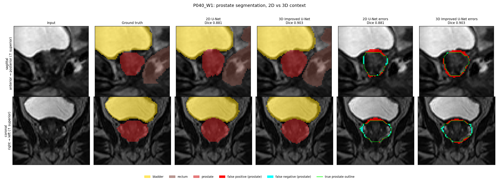
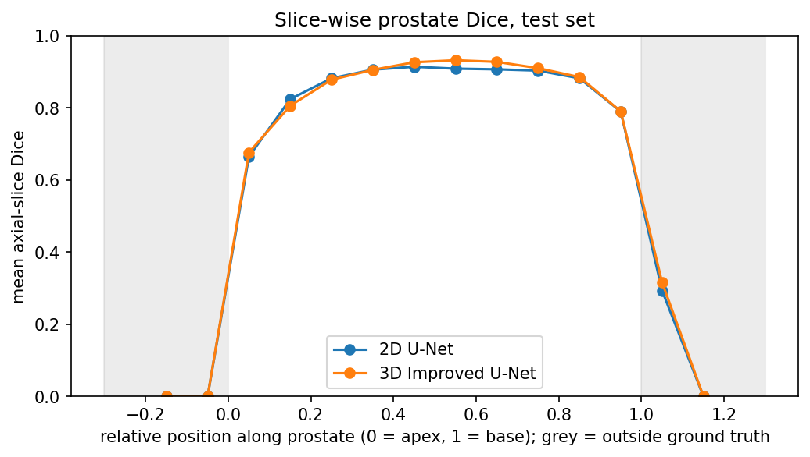
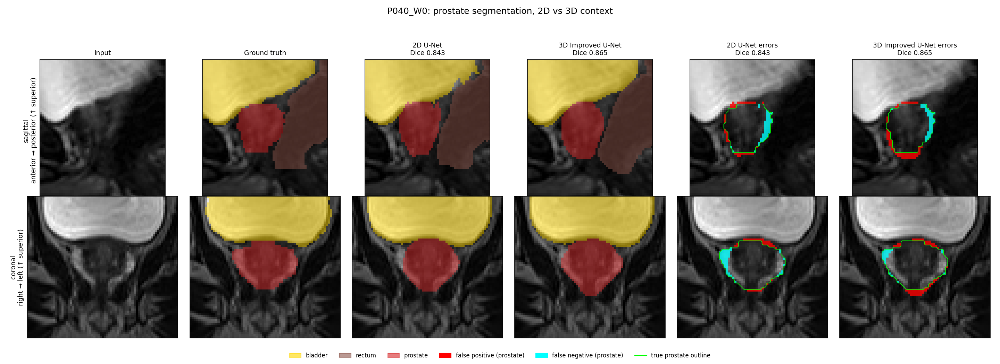
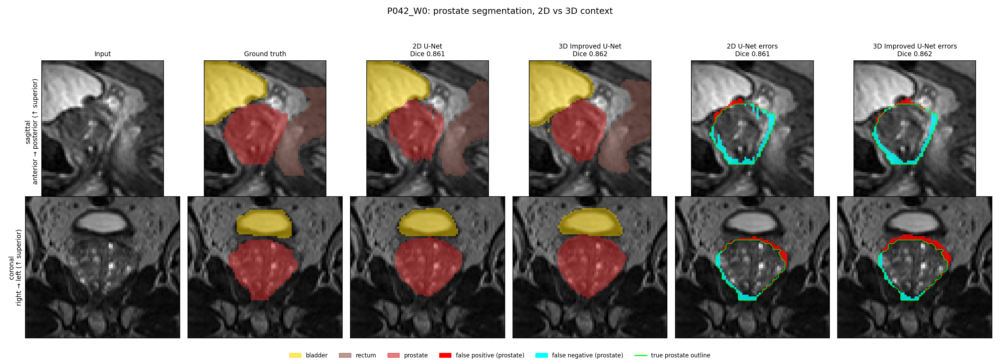
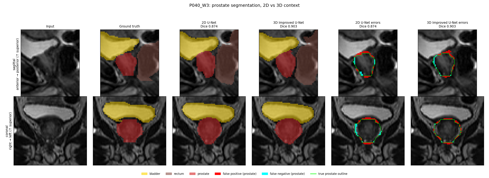
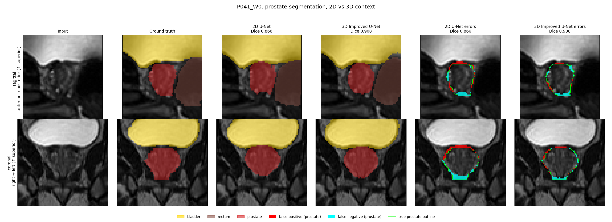
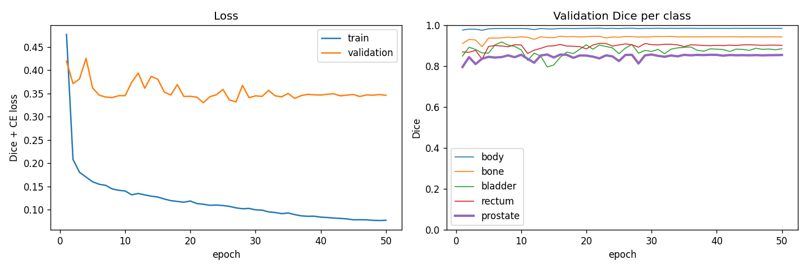
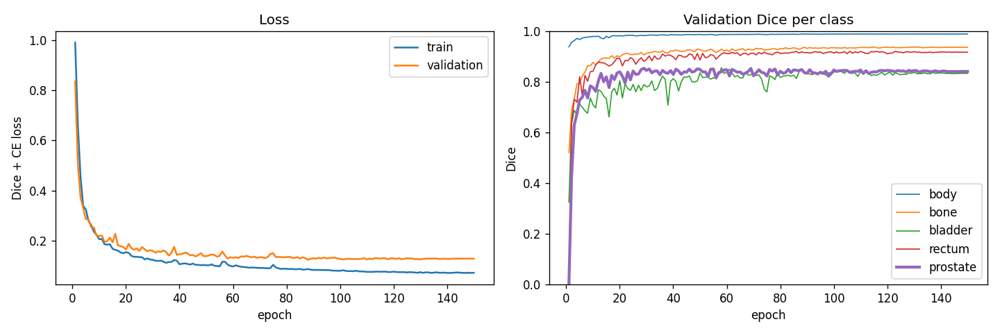

# 3D Improved U-Net Implementation for HipMRI Segmentation

## Algorithm and Problem

### The Problem
The margins for prostate cancer radiotherapy are incredibly slim, where the prostate needs to be contoured to millimeter accuracy to avoid treatment on the bladder and rectum. Under-contouring risks missing parts of the tumor, risking tumor recurrence, and over-contouring can lead to rectal or bladder toxicity. The goal of this project is to be able to generate an annotation assistant that drafts the contours for an imaging specialist to adjust, such that the prostate can be best segmented and help medical professionals deliver the best treatment for patients. The project used the HipMRI dataset, inclusive of 211 MR volumes from 38 patients that were scanned repeatedly over multiple treatment weeks, where each scan was to be given 6 data labels based on the anatomical region (background, body, bone, bladder, rectum, prostate). The prostate only makes up around 0.1% of the voxels in the scan, and so this brings further motivation to how precise these models and analysis must be. It is possible to have a good global Dice score whilst failing to accurately segment basal and apical slices, or the thin rectal and bladder interface, which are commonly attributed to 2D slice-wise models; ack of inter-slice context. This project will look to see if 3D volumetric context helps to fix these errors, or if the use of a 3D model only smooths easy central slices for a far greater computational cost.

### How It Works
This project works to compare 2 machine learning models under identical conditions: the same patient split (training, test, validation groups), loss, augmentation, selection rule and analysis metrics. The first, baseline, model is a 2D U-Net as per Ronneberger et al. (2015), with ~31 million parameters, and works to segment each coronal slice independently. The main model is then the 3D Improved U-Net as per Isensee et al. (2018) with ~9.5 million parameters, and works to segment the entire 256 x 256 x 128 volumes. The improvements consisted of residual context modules (instance norm, leaky ReLU, and dropout) with stride-2 downsampling, and had the upsampling and localisation modules joined by skip connections, as well as deep supervision, where segmentation maps from three decoder levels are upscaled and summed. Training was done through Dice and cross-entropy loss as to handle the major prostate class imbalance, optimised with Adam, bf16 mixed precision, and anatomically plausible augmentation of the data to account for the smaller dataset size. To evaluate the models side-by-side, the 2D model's predictions were restacked into the 3D region, and so both models were compared against the same 3D ground truth. The metrics used for comparison were Dice and IoU, HD95, base and apex extent error, leakage into the bladder and rectum, and a slice-wise Dice profile.

*Figure 1: Test case P040_W1 in sagittal (top) and coronal (bottom) views: input MRI, ground truth, 2D U-Net and 3D Improved U-Net predictions (bladder yellow, rectum brown, prostate red), and prostate error maps (false positives red, false negatives cyan, true outline green)*

## Feasibility Review

### User Need, Scope, and Acceptance Criteria
The intended user would be prostate radiotherapists. The project works to segment HipMRI scans to classify the matter as prostate or non-prostate, such that targeted external-beam radiotherapy can be performed to treat the prostate only. There are negative impacts to misclassification in either direction, and the error margin is very small and so it is important to have highly accurate segmentations. Acceptance criteria will be:
1. **Standard Global Dice Score**: Aim for ≥ 0.7
2. **Slice-Wise Dice Profile**: A Dice score per slice, and can be compared across the model and baseline to show the specific regions of greatest improvements
3. **Hausdorff Distance (HD95 specifically)**: This works to give make the statement that ‘95% of the estimated boundary is within {HD95} of the true boundary’. It determines the distance between the true and estimated boundaries
4. **Craniocaudal Extent Error**: This is a signed difference between the estimated base and apex, and the true base and apexes of the boundary. These are the problem areas, and the sign determines what type of error occurs; under or overshooting.

### Model Choice and Course Concepts
The proposed dataset will be using HipMRI data. The proposed model will be a 3D improved U-net, with improvements from residual units and deep supervision. This fits into the **Hard** difficulty band and will use the baseline of a 2D U-net. A study by Yang et al. (2024) used multiple models for brain hippocampus segmentation on MR images and found the improved 3D U-net model with a filling technique to give better performance than the standard 3D U-net. The results showed an average Hausdorff distance of 5.1235 ± 1.4397, and a global Dice score of 0.7989 ± 0.0398. The improvements were different; however it brings motivation to trying other improvements and aiming for similar results.

### Preliminary Feasible Evidence
Within the HipMRI dataset, there are 211 3D MRI volumes from 38 patients, with labelled segmentations performed by experienced MR physicists. The segmentation is done into background, body, bone, bladder, rectum and prostate. 

### Risk, Budget and Fallback
The data houses an image input size of 256 x 256 x 128, with each voxel size being on average 1.68 x 1.68 x 1.56 mm. This is a limitation to the accuracy that the HD95 and extent error can give, and a risk would be that the improvements to the 3D U-net bring worse performance. The computation will be run on the Google Colab A100, and a fallback would be the standard 3D U-net ([Normal] difficulty) as this is known to work from Yang et al. (2024)

### Changes Since the Feasibility Review
1. **Scope**: All six classes were trained, as opposed to the proposed prostate vs. non-prostate. This was done as a later decision to be able to measure leakage into the bladder and rectum directly.

## Data Pre-Processing

### Dataset Structure
The 3D data consisted of 211 volumes of dimension 256 x 256 x 128 in an LPS orintetaion. The `semantic_MRs` were the images themselves, and the `semantic_labels_only` were the given labels.

The 2D data was given as `keras_slices_data`, and had already been split into train, validate and test sets.

The data labels available to be assigned to voxels are as follows: 0 background, 1 body, 2 bone, 3 bladder, 4 rectum, 5 prostate.

### Relationship of 2D and 3D Data
There was an undocumented mapping between the 2D and 3D datasets. The 2D data was the central 60 coronal slices of each 3D volume, and could be given found through, given a 2D slide `k`, `flipud(volume[:, 98 + k, :])` for k = 0-59. When trying to see the relationship between the 2D and 3D data, the correlation mapping was 1.000, and through checking each of the 211 volumes, there were no mismatches. This is then coded into `evaluation.py` which checks this again on every test case.

This relationship becomes important as it let the 2D predictions be restacked and scored against the same 3D ground truth as the 3D model predictions. Also, because the 2D slices are coronal, the 2D model sees the full base-apex extent in every image, and so the inter-slice context missing is front-back as opposed to head-foot.

### Data Quality Findings
There was a single volume found to be of a different dimension, 256 x 256 x 144, and so for the K019_Week1 volume from the training set, there was an additional 16 slices. It was clipped to 128 slices along the head-foot axis to match the 3D loader's clip from Appendix B, and the clip was also added to the 2D loader. In doing so, in scanning and estimating the clipped slices, it was ensure that the prostate was fully kept, as prostate was only detected in slices 70-104.

It was also found that there was some in-plane spacing variation across the data, with pixel size varying between 1.41-1.88mm. It should be noted, however, that the slice spacing remained consistent at 1.56mm. This suggests that although each slice is the same size, each volume has the same pixel dimensions, but pixel size varies between volumes, and so metrics that are measured in millimeters cannot be taken as a multiplication of an average, and instead need to consider the pixel's true size. This is handled in `evaluation.py`, where each volume's unique spacing is read from its header. This is mostly important for the HD95 metric which converts pixel distances to mm, and extent errors use the slice spacing which is consistent for all slices. The volumes are not resampled to introduce consistency and in a conscious attempt to not break the 2D-to-3D slab mapping, instead they are just handled, and augmentation using a 0.9-1.1x scale covers a similar range.

It was also found that the prostate extends beyond the 60-slice slab in 4 training volumes (M004_Week4, M015_Week0/4/7), by up to 10 slices at the back. Given the 2D dataset only covers the 60 slices, the prostate is not fully covered in the 2D data for these scans, and so some of the boundaries, problem areas for 2D models, will be missed. Luckily these scans were not in the test set, and so regions of the prostate will not be considered missed even though they were never available to be segmented anyways. They instead appeared in the training set, but having 4 of 191 training volumes would lead to very minor variations.

It was also discovered that the 2D slice headers reported 1mm spacing, although this was an incorrect conclusion. Instead, the true spacing is taken from the 3D volumes, given the 2D data is a subset of the coronal slices, and so the headers need to be ignored and taken as spacing from 3D volumes instead.

### Loading and Normalisaition
The Nifti loaders from Appendix B of the spec sheet were used, however in checking over the code it was found that there were 2 variables, `orient` and `interp`, that were redundant. As good code practice, these were removed, however this was done as not to mislead readers, given `orient` was documented as resampling an image, which never occurred. Also, there was a column clip added to `load_data_2d` for the 144 slice volume to be clipped down.

There was also a slight issue with `to_channels` which should be noted. The Appendix B code created one channel per class present in the data, however writes class `c` into channel `c`. Slices missing a class can crassh `load_data_2d` or silently lose classes. The labels are loaded as class indices using `categorical=False`, however, which steers away from this problem.

Following Appendix B normalisation, there is a z-score per image, per slice for 2D, and per volume for 3D, and each split is pre-laoded into RAM.

### Augmentation

The augmentation was identical for both models, and was only used to increase the training data sample size artificially. 
1. Given general pelvic symmetry, **left-right flips** of images were done as this would still lead to anatomically plausible outcomes. 
2. There was also **rotation of up to 10°** in either direction, and 0.9-1.1x scaling that are computed in millimeter space, given the voxels are anisotropic. The labels were given through nearest-neighbour resampling
3. There was also some **changes in contrast and brightness by up to 10%**, as well as the **introduction of some Gaussian noise (σ = 0.05)** to augment the intensity of the images

Each augmentation was only applied to training batches, applied with probabilitiy 0.5, and ran on the GPU.

## Training, Validation and Test Splits
*Table 1: Table summary of patient-wise training, validation, and test split*

| Split | Patients | No. of patients | 3D volumes | 2D slices |
|---|---|---|---|---|
| Training | 4–35 | 31 | 191 | 11,460 |
| Validation | 36–39 | 4 | 11 | 660 |
| Test | 40–42 | 3 | 9 | 540 |
| **Total** | 4–42 | **38** | **211** | **12,660** |

The splits were done at the patient level, as each patient has several scans across treatment weeks. Alternatively, splits could have been done by scan, however this was decided against as it could leak near-identical anatomy between training and test sets. If a model was trained on anatomy it will be seeing during testing, then the outcome of the test would be biased, and so it is best to test the models on anatomy they have never seen before. The official 2D split is used for both models, and so they are tested on exactly the same cases. Within the code base, there is a function `check_no_leakage` in `dataset.py` to enforce the patient-level splitting. There is a limitation, however, in that the test set is small, and it should be noted that 7 of the 9 volumes were from the same patient, and so it's effectively only 3 patients.

## Open Research Dilemma

### Benchmarking
*Table 2: prostate, test set, inside the shared slab, mean ± std over 9 volumes*

| Metric | 2D U-Net | 3D Improved U-Net |
|---|---|---|
| Dice | 0.870 ± 0.013 | **0.884 ± 0.017** |
| IoU | 0.770 ± 0.020 | **0.792 ± 0.027** |
| HD95 (mm) | 3.59 ± 0.66 | **3.21 ± 0.81** |
| Base extent error (mm, + = over) | +3.29 ± 1.15 | **+2.77 ± 1.23** |
| Apex extent error (mm, + = over) | +2.43 ± 2.22 | **+2.25 ± 2.09** |
| Connected components | 1.0 | 1.0 |
| Prostate predicted in bladder (mL) | 0.50 ± 0.24 | **0.15 ± 0.11** |
| Rectum predicted in prostate (mL) | 0.147 ± 0.380 | **0.071 ± 0.171** |
| Prostate predicted in rectum (mL) | **0.000** | 0.003 ± 0.008 |
| Missed prostate (mL) | 3.80 ± 3.49 | **2.49 ± 2.88** |
| Extra prostate (mL) | **3.71 ± 1.09** | 4.58 ± 1.73 |

*Table 3: other classes, Dice inside the slab*

| Class | 2D U-Net | 3D Improved U-Net | 3D (full volume) |
|---|---|---|---|
| Body | **0.984** | 0.982 | 0.985 |
| Bone | **0.941** | 0.928 | 0.917 |
| Bladder | **0.961** | 0.954 | 0.952 |
| Rectum | **0.835** | 0.818 | 0.791 |
| Prostate | 0.870 | **0.884** | 0.884 |

*Table 4: slice-wise profile*

| Region | 2D U-Net | 3D Improved U-Net |
|---|---|---|
| Apex (lowest 20%) | 0.736 | 0.734 |
| Middle 60% | 0.904 | **0.914** |
| Base (top 20%) | 0.821 | **0.827** |
| Over-shoot slices below apex (total) | 16 | 15 |
| Over-shoot slices above base (total) | 19 | **16** |

*Figure 2: Figure 2: Mean axial-slice prostate Dice along the gland (0 = apex, 1 = base) for both models; grey regions are slices outside the ground-truth prostate*

Both models pass the targets, with the 2D model clearing the >0.75 Dice for the 2D U-Net, and the 3D model clearing the >0.7 Dice for the 3D Improved U-Net. Across both models, each test case was above 0.84. There was also consistent improvements seen from the 3D model, with a +0.014 Dice and a -0.38mm HD95, and overall being better in 7 of the 9 cases. The greatest benefits from the 3D model are at the organ interfaces, where there is 70% less prostate predicted in the bladder than in the 2D model, the rectum-in-prostate metric reduced by 50%, and 35% less missed prostate.

The greatest risk with the 3D model, however, is over-contouring. The 2D model had problems with under-contouring, and so the 3D model effectively trades the recurrences risk for toxicity risk, however importantly the extra volume is not in the bladder or rectum which is positive. The 3D model also doesn't work to ammend the basal overshoot, as the aopex error pattern remains problemtic.

In looking at the slice profile, both models show an inverted U. the 3D model's improvement is concentrated in the middle 60% of a volume, with no gain at the apex and only marginal gain at the base. This works to suggest that the 3D model mostly works to "smooth easy slices" as mentioned in the brief. This can be explained given that the coronal slides already contain the full head-foot extent, and so the 3D model is has only little to learn/improve on, and the end slices have small-cross sectional areas in which the Dice is inherently unstable.

It is also interesting to note that the 3D model perfromed slightly worse on bone, rectum and bladder segmentation.

The major limitation to the benchmarking comparison was that there were only 9 test volumes, which were made up of 3 patients, and so the differences between the models were consistent but lacked enough data to be statistically established and quanitified.

It is also worth noting that the methodolgoy differed slightly in model traninig, where both the models were taken to convergence, however the 2D model was trained on only 50 epochs as opposed to the 150 epochs. This difference in computing budget was due to the 3D model having a smaller batch size, and a smaller number of optimiser updates per epoch. The 3D model had approximately fewer updates per epoch given the fewer data units and smaller batch size, and there was also around an 60% increase in computational time per epoch between the 2D and 3D model. TGherefore, 150 was a choice to balance a more comparable number of updates with training time. Both models also used the same pre-set rule of taking the best validation prostate Dice as the metric, which was epoch 14 for the 2D model, and epoch 29 for the 3D model.

### Computational Efficiency Table
*Table 5: Measured with `profiling.py` on an NVIDIA A100-SXM4-40GB, PyTorch 2.11.0, bf16 autocast; mean ± std over 20 timed runs after 5 warm-up runs. Inference excludes disk loading; one scan = 60 slices (2D) or one volume (3D)*

| Metric | 2D U-Net | 3D Improved U-Net | 3D / 2D |
|---|---|---|---|
| Parameters | 31,036,806 | 9,464,674 | 0.30× |
| Checkpoint size (MB) | 124.2 | 37.9 | 0.31× |
| Training batch | 16 slices | 2 volumes | – |
| Peak training VRAM, allocated / reserved (GB) | 2.03 / 2.40 | 16.17 / 22.88 | ~8× / ~9.5× |
| Training step time (ms) | 39.0 ± 0.1 | 473.5 ± 0.1 | ~12× |
| Epoch time (s) | 31.4 | 51.0 | 1.6× |
| Epochs / total training time (min) | 50 / 26 | 150 / 128 | ~4.9× |
| Peak inference VRAM per scan, allocated / reserved (GB) | 2.43 / 2.99 | 3.24 / 4.41 | ~1.3× / ~1.5× |
| Inference latency per scan (ms) | 31.4 ± 0.0 | 131.8 ± 0.1 | ~4.2× |

The brief suggested the 3D model use 5-10x the GPUs memory, and this holds for training, but not for inference. 8x the GPU memory was allocated for training, and 9.5x was reserved, by only 1.3x was needed for inference. The memory cost for the 3D model is predominantly a one-off training cost. With the 3x greater epoch count for the 3D model, the training time was approx. 5x longer overall even though it reached the spec checkpoint in 7mins compared to 25mins for the 2D model. The 3D models inference was about 4x slower, although both models were under 0.2s per scan, which is negligible compared to the time spent for specialists to review the contours. The 3D model was about 3x smaller in parameters, as the cost of the 3D model primarily comes from the size of the volumes as opposed to the model weights. 

### Failure cases
1. *Figure 3: Failure case 1 - P040_W0: under-contouring, partly at the rectal interface*

    * 2D model misses 20% of the gland (6.28 of 31.1mL), with 5.03mL into the body and 1.22mL into the rectum
    * 3D model improved to 4.10mL and 0.55mL. Front-back continuity helps at the rectum but most of the miss is still the soft tissue, classed as "body"
    * Likely cause: poorly defined posterior and lateral boundary
    * Clinical consequence: under-contouring risks missing posterior tumour
2. *Figure 4: Failure case 2 - P042_W0: abnormally large gland*

    * The gland was 67.4mL which is 2-3x the size of every other test gland (22-31mL)
    * 2D model misses 19% of it, almost all into the body (12.82mL)
    * 3D model misses 14% of it, and the extra prostate nearly doubles. It shifts the boundary without being more correct
    * Likely cause: the model seeing a gland of different magnitude to what it was trained on
    * Clinical consequence: missing part of the gland can lead to a high recurrence risk if left unreviewed
3. *Figure 5: Failure case 3 - P040_W1: base overshoot into the bladder, 3D improvement*

    * The 3D model reduces the 0.40mL prostate-bladder overshoot to 0.04mL
    * The extra prostate is almost all body, and so it helps to improve the organ interface
    * Clinical consequence: bladder overshoot means irradiating the bladder wall, which 3D model fixes
4. *Figure 6: Failure case 4 - P040_W3: metric limitation*

    * 3D model bladder leakage was 90% lower than the 2D model, but the base extent error was one slice worse
    * 3D model also labels 0.20mL of the prostate as bladder, so the base boundary is shifted slightly rather than improving
    * The extent metric only reflects the topmost predicted slice, so a thin sliver counts as a large overshoot, and as such is a metric limitation
    * Clinical consequence: little clinical difference, metric only overstates the 3D model error
5. *Figure 7: Failure case 5 - P041_W0: apex under-contouring in both models*

    * Apex -1.6mm for both models, and the missed tissue is all body
    * The 3D model is much tighter in all other locations, but does not move the apex boundary
    * Clinical consequence: apex under-contouring risks missing apical tumour across both models use

Abnormally large glands are difficult for either mdoel to work with, and the apex region is generally a problem area that the 3D model struggles to improve upon. Most issues also come from miss classification of the soft tissue ("body") classification. The organ interfaces is where the 3D model improves the most.

### Engineering Recommendation
The use of the 3D model gives a consistent, but slight, gain, mainly at the organ interfaces, but it doesn't fix the apex, large glands, or the soft-tissue boundaries. The gain is small due to the 2D coronal slices already containing the full base-to-apex extent, and the cost of the 3D model is mostly one-off training, and inference will still give under 0.2s per scan. 

**Recommendation**: It is recommended to use the 3D model for drafting, but mandate the specialist review, especially over the apex, large glands, and soft-tissue boundaries. The specialist should also note that the model tends to favour over-contouring. If possible, the findings should be validated on a larger patient base, as only 3 have been used in this report.

## Example Inputs, Outputs and Plots

**Input:** a T2-weighted pelvic MR volume (256 × 256 × 128) for the 3D model, or its 60 coronal 256 × 128 slices for the 2D model. **Output:** a label map assigning each voxel to background, body, bone, bladder, rectum or prostate. Figure 1 and Figures 3–7 show example inputs, ground truth and both models' predictions with error overlays for test cases; Figure 2 shows the slice-wise Dice profile. The training curves below show loss and validation Dice per class for each model.

*Figure 8: 2D U-Net training and validation loss, and validation Dice per class.*

*Figure 9: 3D Improved U-Net training and validation loss, and validation Dice per class.*

## Dependencies and Reproducibility

Dependencies can be found in the `requirements.txt` file of the code base, using Python 3.13.16. The necessary commands to run the code are as follows:

python train.py --model unet2d --data_dir <HipMRI_Study_open> --out_dir <out>/unet2d

python train.py --model improved_unet3d --data_dir <HipMRI_Study_open> --out_dir <out>/improved_unet3d

python evaluation.py --checkpoint <out>/unet2d/best.pt --data_dir <HipMRI_Study_open> --out_dir <results>/unet2d

python predict.py --checkpoint_2d <out>/unet2d/best.pt --checkpoint_3d <out>/improved_unet3d/best.pt --data_dir <HipMRI_Study_open> --out_dir <figures>

python profiling.py --ckpt_root <out> --out_dir <results>/profiling

sbatch run_rangpur.sh unet2d   # on Rangpur

## Artificial Intelligence Usage Disclosure 
Claude was used to assist with this report. Claude assisted in scaffolding the code base, explaining concepts, debugging code, and suggesting analyses. The prompts and outputs were verified through a correlation check of the 2D-3D mapping on all volumes, visual label checks to ensure the correct segmentation, data split checks and leakage checks, augmentation overlay tests, smoke tests on all scripts across both models, and cross checking `predict.py` and `evaluation.py`.

Claude was able to successfully catch errors in filename-parsing, catching the 144 sliced volume, and the spacing assumption.

## References

1. O. Ronneberger, P. Fischer, and T. Brox, "U-Net: Convolutional networks for biomedical image segmentation," in *Proc. Medical Image Computing and Computer-Assisted Intervention (MICCAI)*, 2015, pp. 234–241.
2. F. Isensee, P. Kickingereder, W. Wick, M. Bendszus, and K. H. Maier-Hein, "Brain tumor segmentation and radiomics survival prediction: Contribution to the BRATS 2017 challenge," in *Brainlesion: Glioma, Multiple Sclerosis, Stroke and Traumatic Brain Injuries (BrainLes 2017)*, 2018, pp. 287–297.
3. Yang et al., "An improved 3D-UNet-based brain hippocampus segmentation model based on MR images," *BMC Med Imaging*, 2024. Available: https://pubmed.ncbi.nlm.nih.gov/38970025/
4. COMP3710 Pattern Recognition and Analysis, *Report task sheet*, The University of Queensland, 2026 — Appendix B, "Reading Nifti Files" (NIfTI loading functions adapted in `dataset.py`).